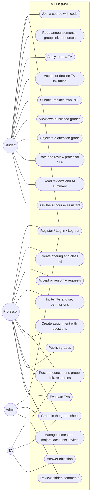
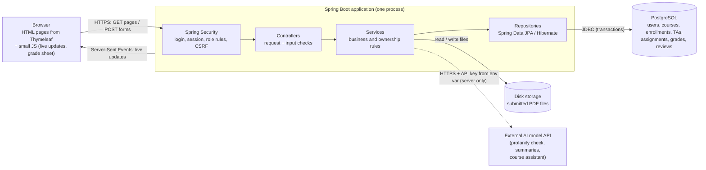
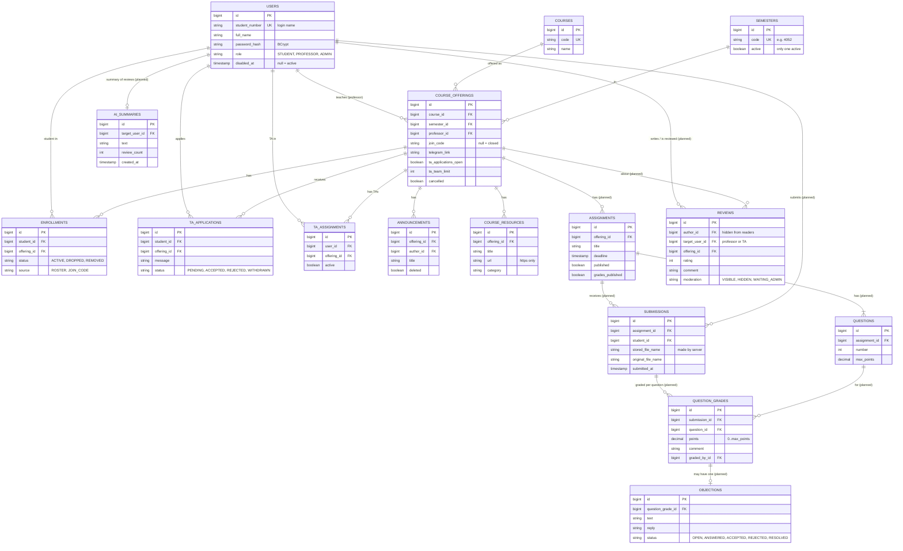

<div dir="rtl">

# TA Hub

همه‌ی کارهای یه درس دانشگاهی، توی یه برنامه.

- درس: تحلیل و طراحی سیستم‌های نرم‌افزاری، پاییز ۱۴۰۵
- پروتوتایپ کلیک‌پذیر: https://sherviiinn.github.io/TAHub/prototype/
- نسخه‌ی آنلاین: در مرحله‌ی نهایی اضافه می‌شه
- نسخه‌ی ارائه‌ی ۱: برچسب `presentation-1`

---

## ۱. مسئله و هدف

### مسئله
الان دانشجو و استاد برای کارهای یه درس مجبورن بین چند برنامه جابه‌جا بشن:
- تمرین‌ها توی کوئرا فرستاده می‌شن.
- نمره‌ها توی گوگل شیت نگه داشته می‌شن.
- اطلاعیه‌ها و لینک گروه‌های درسی توی کانال‌های پراکنده‌ی تلگرام پخش‌ان.

TA شدن هم معمولاً حضوریه و باید دنبال استاد گشت. این برای دانشجویی که از شهر دیگه میاد و همیشه دانشگاه نیست سخته.

موقع انتخاب واحد هم دانشجوها جای مشخصی ندارن که ببینن بقیه درباره‌ی یه استاد چی می‌گن، و باید از اینور و اونور بپرسن.

### هدف: یه برنامه به‌جای چند برنامه
1. **TA شدن از راه دور:** دانشجو درخواست می‌ده، استاد قبول یا رد می‌کنه، و نتیجه همون‌جا دیده می‌شه.
2. **تمرین و تصحیح:** تحویل تکلیف به‌صورت PDF و نمره‌دهی با یه جدول شبیه گوگل شیت، و اعتراض به نمره.
3. **صفحه‌ی هر درس:** اطلاعیه‌ها، لینک گروه تلگرام و منابع آموزشی یه‌جا.
4. **نظر دانشجوها درباره‌ی استاد و TA:** برای کمک به انتخاب واحد، با هوش مصنوعی که نظرهای توهین‌آمیز رو جدا می‌کنه و نظرها رو خلاصه می‌کنه.

### کاربرها
| کاربر | کارش |
|---|---|
| دانشجو | ورود به درس‌ها، دیدن اطلاعیه و لینک‌ها، تحویل تمرین، دیدن نمره‌ی خودش، اعتراض، درخواست TA شدن، نظر دادن درباره‌ی استاد و TA |
| استاد | ساختن درس، لیست کلاس، قبول و رد درخواست‌های TA، تمرین، نمره‌دهی و انتشار نمره |
| TA (دستیار آموزشی) | دانشجوییه که توی یه درس دیگه TA شده؛ نمره‌دهی، اطلاعیه و جواب اعتراض، با دسترسی‌هایی که استاد بهش داده |
| ادمین | ترم‌ها، رشته‌ها، حساب‌ها، کد دعوت استادها و بررسی نظرهای پنهان‌شده |

### MVP: مسیرهای اصلی
1. **TA شدن:** دانشجو درخواست می‌ده ← استاد قبول یا رد می‌کنه ← دانشجو TA می‌شه و استاد دسترسی‌هاش رو تعیین می‌کنه.
2. **تمرین:** استاد تمرین با سؤال و بارم می‌ذاره ← دانشجو PDF تحویل می‌ده ← TA توی جدول نمره برای هر سؤال نمره می‌ذاره ← استاد منتشر می‌کنه ← دانشجو فقط نمره‌ی خودش رو می‌بینه و اگه لازم بود اعتراض می‌کنه.
3. **صفحه‌ی درس:** دانشجو با کد یا لیست کلاس وارد درس می‌شه و اطلاعیه‌ها، لینک تلگرام و منابع رو یه‌جا می‌بینه.
4. **نظرسنجی:** دانشجو به استاد و TA امتیاز می‌ده و نظر می‌نویسه ← فیلتر فحش چکش می‌کنه ← بقیه نظرها و خلاصه‌ی هوش مصنوعی رو توی صفحه‌ی استاد می‌بینن.

---

## ۲. اولویت‌بندی همه‌ی قابلیت‌ها (MoSCoW)

اولویت یعنی «چقدر برای MVP لازمه»، نه اینکه ساخته شده یا نه. ستون وضعیت جدا نشون می‌ده چی ساخته شده.
**ساخته شده** = کار می‌کنه و دستی تست شده · **تست نشده** = کدش نوشته شده و تستش مونده · **مونده** = هنوز ساخته نشده

### باید باشه (Must Have)
| قابلیت | فاز | وضعیت |
|---|---|---|
| ثبت‌نام دانشجو با شماره‌ی دانشجویی | ۱ | ساخته شده |
| ورود و خروج، و دسترسی بر اساس نقش | ۱ | ساخته شده |
| ثبت‌نام استاد با کد دعوت ادمین | ۱ | تست نشده |
| ساختن درس و ارائه‌ی هر ترم | ۲ | ساخته شده |
| ورود دانشجو به درس با کد یا لیست کلاس، و «درس‌های من» | ۲ | ساخته شده |
| درخواست TA شدن و قبول یا رد استاد | ۲ | ساخته شده |
| دعوت دانشجو به TA شدن | ۳ | ساخته شده |
| اطلاعیه‌ی درس | ۳ | ساخته شده |
| لینک گروه تلگرام و منابع آموزشی درس | ۳ | ساخته شده |
| تمرین با سؤال، بارم و مهلت | ۴ | مونده |
| تحویل PDF (عوض کردن و حذف تا قبل از مهلت) | ۴ | مونده |
| جدول نمره شبیه گوگل شیت و نمره‌دهی سؤال‌به‌سؤال | ۵ | مونده |
| انتشار نمره (هر دانشجو فقط نمره‌ی خودش) | ۵ | مونده |
| اعتراض به نمره و جواب TA | ۶ | مونده |
| نظرسنجی استاد و TA | ۸ | مونده |
| فیلتر فحش با هوش مصنوعی | هوش مصنوعی | مونده |
| خلاصه‌ی نظرها با هوش مصنوعی | هوش مصنوعی | مونده |
| دستیار درسی با هوش مصنوعی | هوش مصنوعی | مونده |

### بهتره باشه (Should Have)
| قابلیت | فاز | وضعیت |
|---|---|---|
| نوتیفیکیشن، با عدد زنده و بدون رفرش | ۳ | ساخته شده |
| صفحه‌های زنده (بدون رفرش، با حفظ چیزی که کاربر نوشته) | ۳ | ساخته شده |
| دسترسی‌های جدا برای هر TA، Head TA و سقف تیم | ۳ | ساخته شده |
| بخش اساتید و اطلاعات دفتر استاد | ۲ و ۳ | ساخته شده |
| اطلاعیه‌ی ادمین برای کل سایت | ۳ | ساخته شده |
| پنل حساب‌ها (غیرفعال کردن، آزاد کردن شماره) و فرمت شماره‌ی دانشجویی | ۱ | تست نشده |
| دیدن PDF داخل سایت | ۵ | مونده |
| خروجی CSV از جدول نمره | ۵ | مونده |
| ارزیابی پایان ترم TA توسط استاد | ۸ | مونده |

### اگه وقت شد (Could Have)
| قابلیت | فاز | وضعیت |
|---|---|---|
| منوی سلف و یادآوری رزرو | ۳ | ساخته شده |
| بانک سؤال با راه‌حل‌های بچه‌ها و رأی | ۷ | مونده |
| برنامه‌ریز درسی و تشخیص تداخل | ۹ | مونده |
| هماهنگی تاریخ میان‌ترم بین استادها | ۹ | مونده |
| استخدام TA با رزومه و پیشنهاد TA | ۱۰ | مونده |
| پنل «درس‌هایی که TA هستم» | – | مونده |
| درخواست بازبینی برای TAای که حذف شده | – | مونده |
| «درخواست به ادمین» (گزارش باگ و ...) | – | مونده |
| پنجره‌ی کوچیک برای نوتیفیکیشن تازه | – | مونده |
| تأیید دانشجو با عکس کارت دانشجویی | – | مونده |
| رابط فارسی و راست‌به‌چپ | – | مونده |
| فایل اجرایی ویندوز یا نسخه‌ی موبایل (PWA) | – | مونده |

### این ترم نه (Won't Have)
- وصل شدن به سامانه‌های خود دانشگاه (مثل گلستان)
- اپ iOS
- پرداخت
- چت زنده
- ساختن مدل هوش مصنوعی از صفر (از یه سرویس آماده استفاده می‌کنیم)

---

## ۳. داستان‌های کاربر و معیارهای پذیرش

قالب: «به‌عنوان [کاربر]، می‌خوام [کار]، تا [فایده]».

### باید باشه (Must Have)

**US-01: ثبت‌نام دانشجو**
به‌عنوان دانشجو، می‌خوام با شماره‌ی دانشجویی‌ام حساب بسازم، تا وارد درس‌هام بشم.
- شماره باید با فرمت دانشگاه بخونه (۱۱ رقم که سه رقم اولش سال ورودیه). شماره‌ی اشتباه با پیام واضح رد می‌شه.
- شماره‌ی تکراری قبول نمی‌شه.
- رمز به‌صورت رمزنگاری‌شده ذخیره می‌شه، نه متن ساده.
- اگه استادها این شماره رو قبلاً توی لیست کلاسشون گذاشته باشن، دانشجو بعد از ثبت‌نام خودکار وارد اون درس‌ها می‌شه.

**US-02: ورود و خروج**
به‌عنوان هر کاربر، می‌خوام وارد و خارج بشم، تا فقط خودم به اطلاعاتم دسترسی داشته باشم.
- با اطلاعات درست وارد می‌شه و صفحه‌ها بر اساس نقشش نشون داده می‌شن.
- با رمز اشتباه وارد نمی‌شه و پیام خطا می‌بینه.
- کسی که وارد نشده، با باز کردن هر صفحه‌ی داخلی به صفحه‌ی ورود فرستاده می‌شه.
- حساب غیرفعال‌شده نمی‌تونه وارد بشه.

**US-03: ثبت‌نام استاد با کد دعوت**
به‌عنوان استاد، می‌خوام با کدی که ادمین بهم داده حساب بسازم، تا منتظر ساختن حساب توسط ادمین نمونم.
- کد ۱۰ حرفیه، یه بار مصرف می‌شه و ۱۴ روز اعتبار داره.
- کد اشتباه، استفاده‌شده، لغوشده یا منقضی رد می‌شه و هیچ حسابی ساخته نمی‌شه.
- از راه ثبت‌نام معمولی نمی‌شه نقش استاد گرفت.

**US-04: ساختن ارائه‌ی درس**
به‌عنوان استاد، می‌خوام درسم رو برای ترم فعال ارائه کنم، تا دانشجوها و TAها واردش بشن.
- همون درس، توی همون ترم، با همون استاد دو بار ساخته نمی‌شه.
- دانشجو نمی‌تونه ارائه بسازه (خطای ۴۰۳).
- ارائه‌های ترم‌های قبل فقط دیدنی‌ان و پاک نمی‌شن.

**US-05: ورود دانشجو به درس**
به‌عنوان دانشجو، می‌خوام با کد ورود یا از روی لیست کلاس وارد درس بشم، تا همه‌چیز درس رو یه‌جا ببینم.
- با کد درست ثبت‌نام می‌شه و بعد از رفرش هم سر جاشه. کد اشتباه پیام خطا می‌ده.
- استاد لیست شماره‌ها رو می‌چسبونه: کسایی که حساب دارن همون موقع وارد می‌شن، بقیه موقع ثبت‌نام.
- دانشجویی که استاد حذفش کرده نمی‌تونه خودش برگرده (۴۰۳).
- درس‌های هر دانشجو توی «درس‌های من» میان، با امکان دیدن ترم‌های قبل.

**US-06: درخواست TA شدن**
به‌عنوان دانشجو، می‌خوام بدون رفتن به دانشگاه برای TA شدن درخواست بدم، تا از هر شهری بتونم TA بشم.
- فقط وقتی استاد پذیرش درخواست رو باز کرده، می‌شه درخواست داد. برای هر درس یه درخواست، با یه پیام کوتاه اختیاری.
- استاد نوتیفیکیشن می‌گیره و توی صفحه‌ی «درخواست‌های TA» قبول یا رد می‌کنه. دانشجو وضعیت درخواستش رو (در انتظار، قبول، رد) توی «درخواست‌های TA من» می‌بینه.
- با قبول، دانشجو TA اون درس می‌شه و استاد دسترسی‌هاش رو تعیین می‌کنه.
- دانشجوی همون درس نمی‌تونه TAش بشه. وقتی تیم به سقفش رسیده، درخواست قبول نمی‌شه.
- دانشجو می‌تونه درخواستش رو پس بگیره و دوباره بده. رد اشتباهی رو استاد برمی‌گردونه.

**US-07: دعوت به TA شدن**
به‌عنوان استاد، می‌خوام یه دانشجو رو مستقیم به TA شدن دعوت کنم، تا لازم نباشه منتظر درخواستش بمونم.
- دعوت‌شده نوتیفیکیشن می‌گیره و خودش قبول یا رد می‌کنه. تا قبول نکنه TA نمی‌شه.
- قانون‌های US-06 (دانشجوی همون درس نباشه، تیم پر نباشه) اینجا هم چک می‌شن.
- فقط استاد یا TAای که اجازه‌ی مدیریت تیم داره می‌تونه دعوت کنه.

**US-08: اطلاعیه‌ی درس**
به‌عنوان استاد یا TA، می‌خوام برای درس اطلاعیه بنویسم، تا لازم نباشه توی کانال‌های جدا پخشش کنم.
- فقط استاد، TAها و دانشجوهای فعال همون درس اطلاعیه رو می‌بینن. بقیه خطای ۴۰۳ می‌گیرن.
- دانشجوها نوتیفیکیشن می‌گیرن.
- TA فقط اطلاعیه‌ی خودش رو ویرایش یا پاک می‌کنه، مگه اینکه اجازه‌ی مدیریت همه‌ی اطلاعیه‌ها رو داشته باشه.

**US-09: لینک گروه و منابع درس**
به‌عنوان دانشجو، می‌خوام لینک گروه تلگرام و منابع آموزشی درس رو توی صفحه‌ی درس پیدا کنم، تا دنبال کانال‌ها نگردم.
- استاد (یا TA با اجازه) لینک گروه رو می‌ذاره. فقط لینک‌های واقعی تلگرام قبول می‌شن.
- لینک گروه رو فقط اعضای همون درس می‌بینن.
- منابع (یوتیوب، آپارات، درایو، PDF و ...) عنوان و لینک دارن، و دسته‌بندیشون اختیاریه.
- اگه لینک گروه عوض بشه، دانشجوها خبردار می‌شن.

**US-10: ساختن تمرین**
به‌عنوان استاد، می‌خوام تمرین با مهلت، سؤال‌ها و بارم هر سؤال بسازم، تا بعداً سؤال‌به‌سؤال نمره بدیم.
- تمرین عنوان، مهلت و حداقل یه سؤال با بارم بیشتر از صفر داره. جمع بارم خودکار حساب می‌شه.
- تا منتشر نشده، فقط استاد و TAها می‌بیننش. با انتشار، دانشجوهای فعال درس نوتیفیکیشن می‌گیرن.
- دانشجو نمی‌تونه تمرین بسازه یا عوض کنه (۴۰۳).

**US-11: تحویل PDF**
به‌عنوان دانشجو، می‌خوام فایل جوابم رو توی همین برنامه آپلود کنم، تا لازم نباشه برم کوئرا یا برای کسی بفرستم.
- فقط دانشجوی فعال همون درس می‌تونه تحویل بده.
- فقط PDF واقعی و تا یه حجم مشخص قبول می‌شه. سرور خود محتوای فایل رو چک می‌کنه، نه فقط پسوندش رو.
- برای هر تمرین یه تحویل هست. تا قبل از مهلت می‌شه عوضش کرد یا پاکش کرد. بعد از مهلت قفل می‌شه.
- فایل هر دانشجو رو فقط خودش، استاد و TAهای همون درس می‌تونن ببینن. یه دانشجو فایل دانشجوی دیگه رو نمی‌تونه ببینه یا عوض کنه (۴۰۳).

**US-12: جدول نمره**
به‌عنوان TA، می‌خوام نمره‌ی همه‌ی دانشجوها رو توی یه جدول شبیه گوگل شیت وارد کنم، تا لازم نباشه نمره‌ها رو جدا توی گوگل شیت نگه دارم.
- هر ردیف یه دانشجوی فعال درسه. ستون‌ها: اسم، شماره، سؤال ۱، سؤال ۲ و ...، جمع، وضعیت اعتراض.
- نمره‌ی هر خونه بین صفر و بارم همون سؤاله. مقدار بیرون از این بازه ذخیره نمی‌شه و پیام خطا میاد.
- جمع هر ردیف خودکار حساب می‌شه. برای هر سؤال می‌شه توضیح هم گذاشت.
- فقط استاد و TAهای همون درس جدول رو می‌بینن و عوضش می‌کنن. دانشجو و TAهای درس‌های دیگه ۴۰۳ می‌گیرن.

**US-13: انتشار و دیدن نمره**
به‌عنوان دانشجو، می‌خوام بعد از انتشار، نمره‌ی هر سؤالم رو با توضیحش ببینم، تا بدونم کجا نمره از دست دادم.
- تا استاد منتشر نکرده، دانشجو هیچ نمره‌ای نمی‌بینه.
- با انتشار، دانشجوها نوتیفیکیشن می‌گیرن.
- هر دانشجو فقط نمره‌ی خودش رو می‌بینه. درخواست برای دیدن نمره‌ی یکی دیگه رد می‌شه.

**US-14: اعتراض به نمره**
به‌عنوان دانشجو، می‌خوام به نمره‌ی یه سؤال اعتراض کنم، تا لازم نباشه با پیام شخصی پیگیری کنم.
- برای هر سؤال حداکثر یه اعتراض ثبت می‌شه، و فقط برای نمره‌ی خود دانشجو.
- TA یا استاد جواب می‌ده و می‌تونه نمره رو عوض کنه.
- وضعیت اعتراض (باز، جواب‌داده‌شده، پذیرفته، رد، حل‌شده) برای دانشجو دیده می‌شه و توی جدول نمره هم میاد.

**US-15: نظرسنجی استاد و TA**
به‌عنوان دانشجو، می‌خوام به استاد و TAهای درسم امتیاز بدم و نظر بنویسم، تا دانشجوهای بعدی موقع انتخاب واحد بدونن با کی درس دارن.
- فقط دانشجوی همون درس، و برای هر استاد یا TA توی هر ارائه فقط یه بار، می‌تونه نظر بده.
- نظرها بدون اسم نویسنده نشون داده می‌شن، ولی سرور نویسنده رو می‌دونه تا جلوی سوءاستفاده گرفته بشه.
- نظرها و میانگین امتیاز توی صفحه‌ی هر استاد توی بخش اساتید میان.
- هر نظر قبل از نمایش از فیلتر فحش (US-16) رد می‌شه.

**US-16: فیلتر فحش**
به‌عنوان دانشجو، می‌خوام نظرهای توهین‌آمیز نشون داده نشن، تا بخش نظرها محترمانه بمونه.
- هر نظر اول با یه لیست کلمه (فارسی و انگلیسی) چک می‌شه. نظرهای مشکوک به هوش مصنوعی فرستاده می‌شن.
- نظری که نشونه‌دار بشه پنهان می‌شه و برای بررسی به ادمین می‌ره. پاک نمی‌شه.
- ادمین نظر پنهان رو منتشر می‌کنه یا پنهان نگه می‌داره. هیچ کاربر دیگه‌ای نظرهای پنهان رو نمی‌بینه.
- اگه سرویس هوش مصنوعی در دسترس نباشه، نظر مشکوک منتشر نمی‌شه و منتظر ادمین می‌مونه.

**US-17: خلاصه‌ی نظرها**
به‌عنوان دانشجو، می‌خوام یه خلاصه‌ی کوتاه از نظرهای هر استاد یا TA ببینم، تا لازم نباشه همه‌ی نظرها رو بخونم.
- خلاصه فقط وقتی ساخته می‌شه که تعداد کافی نظر منتشرشده باشه.
- فقط متن نظرها به هوش مصنوعی فرستاده می‌شه، بدون اسم و شماره‌ی کسی.
- کنار خلاصه برچسب «ساخته‌شده با هوش مصنوعی» و تاریخ ساختش هست.
- خلاصه ذخیره می‌شه و هر چند وقت یه بار دوباره ساخته می‌شه، نه با هر بار باز شدن صفحه.

**US-18: دستیار درسی**
به‌عنوان دانشجو، می‌خوام سؤال درسی‌ام رو از یه دستیار بپرسم، تا وقتی TA در دسترس نیست هم کمک بگیرم.
- فقط کاربر واردشده می‌تونه بپرسه. هر نفر توی روز تعداد محدودی سؤال داره و بعدش پیام «سقف امروز پر شده» می‌بینه.
- کنار هر جواب برچسب «ممکنه اشتباه باشه» هست.
- اطلاعات شخصی کاربر به سرویس فرستاده نمی‌شه.
- اگه سرویس جواب نده، پیام خطای واضح نشون داده می‌شه.

### بهتره باشه (Should Have)

**US-19: نوتیفیکیشن و صفحه‌های زنده**
به‌عنوان کاربر، می‌خوام برای اتفاق‌های مهم خبردار بشم و صفحه‌ها خودشون به‌روز بشن، تا چیزی رو از دست ندم.
- برای هر موضوع یه نوتیفیکیشن خونده‌نشده هست که با اتفاق جدید میاد بالا، تا لیست شلوغ نشه.
- عدد نوتیفیکیشن‌ها و صفحه‌ها بدون رفرش عوض می‌شن، و چیزی که کاربر توی فرم نوشته پاک نمی‌شه.

**US-20: دسترسی‌های TA و Head TA**
به‌عنوان استاد، می‌خوام برای هر TA مشخص کنم چه کارهایی بکنه، تا هر کس فقط کار خودش رو بکنه.
- Head TA (فقط با تعیین استاد) تیم رو مدیریت می‌کنه، تا سقفی که استاد گذاشته.
- هیچ TAای نمی‌تونه دسترسی‌ای بده که خودش نداره.

**US-21: بخش اساتید و اطلاعات دفتر**
به‌عنوان دانشجو، می‌خوام درس‌ها، TAها و اطلاعات دفتر هر استاد رو ببینم، تا بدونم کجا و چطور پیداش کنم.
- فقط خود استاد یا ادمین اطلاعات دفتر رو عوض می‌کنن. اطلاعات ترم قبل برچسب «ممکنه قدیمی باشه» می‌گیره.

**US-22: اطلاعیه‌ی ادمین**
به‌عنوان ادمین، می‌خوام یه اطلاعیه برای کل سایت بذارم، تا همه از تغییرها و مشکل‌ها خبردار بشن.
- اطلاعیه توی نوار بالای همه‌ی صفحه‌ها میاد و هر کاربر می‌تونه برای خودش ببندتش.

**US-23: پنل حساب‌ها**
به‌عنوان ادمین، می‌خوام حسابی که با شماره‌ی کس دیگه ساخته شده رو غیرفعال کنم و شماره رو آزاد کنم، بدون اینکه چیزی پاک بشه.
- آزاد کردن شماره فقط بعد از غیرفعال کردن، و با تایپ دوباره‌ی شماره انجام می‌شه.

**US-24: دیدن PDF داخل سایت**
به‌عنوان TA، می‌خوام PDF هر دانشجو رو کنار جدول نمره ببینم، تا لازم نباشه دانلودش کنم.
- فقط کسایی که اجازه‌ی دیدن فایل رو دارن (US-11) می‌بیننش.

**US-25: خروجی CSV**
به‌عنوان استاد، می‌خوام از جدول نمره خروجی CSV بگیرم، تا توی اکسل یا گوگل شیت هم داشته باشمش.
- فقط استاد و TAهای همون درس می‌تونن خروجی بگیرن.

**US-26: ارزیابی TA**
به‌عنوان استاد، می‌خوام آخر ترم TAهام رو ارزیابی کنم، تا سابقه‌ی کارشون ثبت بشه.
- فقط استاد همون درس ارزیابی می‌کنه. ارزیابی برای بقیه‌ی دانشجوها دیده نمی‌شه.

### اگه وقت شد (Could Have)
- **US-27:** به‌عنوان دانشجو، می‌خوام منوی سلف و مهلت رزرو هر روز رو ببینم و یادآوری بگیرم، تا رزرو یادم نره. (ساخته شده)
- **US-28:** به‌عنوان دانشجو، می‌خوام سؤال‌های امتحان‌های قبلی و راه‌حل‌های بچه‌ها رو ببینم و بهشون رأی بدم، تا بهتر آماده بشم.
- **US-29:** به‌عنوان دانشجو، می‌خوام برنامه‌ی ترمم رو بچینم و تداخل‌ها رو ببینم، تا انتخاب واحد راحت‌تر بشه.
- **US-30:** به‌عنوان استاد، می‌خوام تاریخ میان‌ترم رو با استادهایی که دانشجوی مشترک داریم هماهنگ کنم، تا امتحان‌ها روی هم نیفتن.
- **US-31:** به‌عنوان استاد، می‌خوام آگهی TA بذارم و رزومه‌ها رو ببینم، تا بهترین TA رو انتخاب کنم.
- **US-32:** به‌عنوان TA، می‌خوام همه‌ی درس‌هایی که توشون TA هستم رو یه‌جا ببینم.
- **US-33:** به‌عنوان TAای که حذف شده، می‌خوام یه بار درخواست بازبینی بدم.
- **US-34:** به‌عنوان کاربر، می‌خوام برای ادمین گزارش یا درخواست بفرستم و جوابش رو ببینم.
- **US-35:** به‌عنوان کاربر، می‌خوام نوتیفیکیشن تازه رو همون لحظه توی یه پنجره‌ی کوچیک ببینم.
- **US-36:** به‌عنوان ادمین، می‌خوام دانشجوها رو با عکس کارت دانشجویی تأیید کنم.
- **US-37:** به‌عنوان کاربر، می‌خوام برنامه رو به فارسی و راست‌به‌چپ ببینم.
- **US-38:** به‌عنوان کاربر، می‌خوام برنامه رو روی ویندوز یا گوشی نصب کنم.

---

## ۴. معماری و دلیل انتخاب‌ها

### معماری
برنامه یه **مونولیت لایه‌لایه** است که صفحه‌ها رو **سمت سرور** می‌سازه. مرورگر صفحه‌ی آماده می‌گیره، و فرم‌ها با درخواست‌های معمولی GET و POST به سرور می‌رن.

| لایه | کجای کد | کارش |
|---|---|---|
| صفحه‌ها | پوشه‌ی `templates` و `static` | نمایش صفحه‌ها و فرم‌ها با Thymeleaf. یه قالب مشترک منو و ظاهر رو یکی می‌کنه. متن‌ها توی `messages.properties` هستن. کمی جاوااسکریپت برای به‌روز شدن زنده. |
| کنترلرها | کلاس‌های `Controller` | گرفتن درخواست، چک ورودی‌ها، صدا زدن سرویس، و برگردوندن صفحه |
| سرویس‌ها | پوشه‌ی `service` | قانون‌ها، مثل اینکه کی چه کاری می‌تونه بکنه (`OfferingAccess`) یا قانون‌های TA شدن (`TaService`) |
| دسترسی به داده | پوشه‌های `repository` و `model` | خوندن و نوشتن توی PostgreSQL با JPA |
| امنیت | `SecurityConfig` و پوشه‌ی `security` | ورود، خروج، session، قانون آدرس‌ها بر اساس نقش، محافظت در برابر CSRF |
| تنظیمات | `application.properties` | آدرس و رمز دیتابیس و بقیه‌ی تنظیمات؛ روی سرور با متغیر محیطی جایگزین می‌شن |

**هر کاری کجا انجام می‌شه:**
- **احراز هویت (کی وارد شده):** Spring Security با فرم ورود و session سمت سرور. رمزها با BCrypt.
- **مجوز (کی چه کاری می‌تونه بکنه):** دو لایه. اول، قانون آدرس‌ها بر اساس نقش، مثلاً صفحه‌های ادمین فقط برای ادمین. دوم، چک مالکیت توی کد، مثلاً «این کاربر استاد یا TA همین درسه؟». قانون آدرس نمی‌دونه هر رکورد مال کیه، و مخفی کردن دکمه هیچ‌وقت تنها محافظت نیست.
- **چک ورودی‌ها:** توی کنترلرها و قبل از ذخیره. اولین خطا با پیام واضح نشون داده می‌شه.
- **ذخیره‌ی داده:** PostgreSQL. فایل‌های PDF روی دیسک سرور ذخیره می‌شن و فقط مسیرشون توی دیتابیسه.
- **هوش مصنوعی:** فقط سرور با سرویس هوش مصنوعی حرف می‌زنه، و کلیدش توی متغیر محیطیه. یه رابط ساده (`AiClient`) بین برنامه و سرویس هست تا بشه سرویس رو عوض کرد و توی تست‌ها یه نسخه‌ی تقلبی جاش گذاشت.

### چرا این انتخاب‌ها
- **جاوا و Spring Boot:** امنیت (ورود، session، محافظت فرم‌ها، رمزنگاری رمز) آماده و جاافتاده‌ست. تیم با جاوا آشناتره.
- **ساخت صفحه سمت سرور به‌جای React و یه API جدا:** فقط یه برنامه داریم که یه بار اجرا و یه بار آنلاین می‌شه، و مدیریت توکن توی مرورگر لازم نیست. برای تیم سه‌نفره توی یه ترم سریع‌تره.
  - **ضعفش:** صفحه‌ها کمتر تعاملی‌ان. جاهایی که لازمه، مثل جدول نمره و به‌روز شدن زنده، کمی جاوااسکریپت داریم. API عمومی برای اپ موبایل هم نداریم، که اگه لازم شد کنار همین سرویس‌ها اضافه می‌شه.
- **PostgreSQL (دیتابیس رابطه‌ای):** داده‌ها به هم وصلن (کاربر، درس، ثبت‌نام، TA، تمرین، نمره، نظر). قیدهای یکتایی و تراکنش لازمه، مثلاً اینکه هر دانشجو برای هر تمرین فقط یه تحویل داشته باشه.
- **داکر برای دیتابیس:** همه‌ی اعضای تیم با یه دستور همون دیتابیس رو بالا میارن.
- **هوش مصنوعی با سرویس آماده (مثل Gemini):** ساختن مدل از صفر توی یه ترم شدنی نیست. سرویس آماده ارزونه و فقط چیزی که لازمه، بدون اطلاعات شخصی، براش فرستاده می‌شه.

### مسیر کامل یه کار، از صفحه تا دیتابیس: درخواست TA شدن
1. **صفحه:** دانشجو توی صفحه‌ی درس یه پیام کوتاه می‌نویسه و دکمه‌ی درخواست TA رو می‌زنه. مرورگر درخواست `POST /courses/{id}/ta-applications` رو با `message` و توکن امنیتی فرم می‌فرسته.
2. **امنیت:** Spring Security از روی session می‌فهمه کاربر کیه. اگه وارد نشده باشه، به صفحه‌ی ورود فرستاده می‌شه.
3. **کنترلر و قانون‌ها:** متد `TaApplicationController.apply` این‌ها رو چک می‌کنه:
   - کاربر دانشجوئه، ترم فعاله و ارائه لغو نشده. اگه نه، خطای ۴۰۳.
   - پذیرش درخواست بازه، تیم پر نیست، پیام زیادی بلند نیست، و دانشجو عضو هیچ گروهی از همین درس نیست (`TaService`). اگه نه، صفحه‌ی درس با پیام خطا باز می‌شه.
4. **دیتابیس:** یه ردیف توی جدول `ta_applications` با وضعیت `PENDING` ذخیره می‌شه. برای هر دانشجو و درس فقط یه ردیف هست. یه نوتیفیکیشن هم برای استاد ساخته می‌شه.
5. **جواب:** دانشجو به صفحه‌ی درس برمی‌گرده و می‌بینه درخواستش در انتظاره. عدد نوتیفیکیشن استاد بدون رفرش زیاد می‌شه، و استاد از صفحه‌ی «درخواست‌های TA» قبول یا رد می‌کنه.

---

## ۵. نمودارها

نمودار مورد کاربرد فقط قابلیت‌های باید و بهتره‌ی MVP رو نشون می‌ده.

</div>

### Use Case


<div dir="rtl">

TA هم یه دانشجوئه، پس همه‌ی کارهای دانشجو رو هم می‌تونه بکنه. کارهای TA به دسترسی‌هایی بستگی داره که استاد بهش داده.

</div>

### Activity: submitting a PDF (with error paths)


### System architecture


### ERD (main MVP tables)


<div dir="rtl">

جدول‌هایی که کنارشون «planned» نوشته شده مال مرحله‌های بعدی‌ان. بقیه الان توی دیتابیس هستن.

**قیدهای مهم:**
- **ثبت‌نام‌ها:** برای هر دانشجو و ارائه فقط یه ردیف. حذف یعنی عوض شدن وضعیت، نه پاک شدن.
- **درخواست‌های TA:** برای هر دانشجو و ارائه فقط یه درخواست.
- **TAها:** برای هر کاربر و ارائه یه ردیف. دانشجوی یه درس نمی‌تونه TA همون درس باشه (توی کد چک می‌شه).
- **ارائه‌ها:** یکتا روی درس، ترم و استاد.
- **تحویل‌ها:** هر دانشجو برای هر تمرین فقط یه تحویل.
- **نمره‌ها:** برای هر تحویل و سؤال یه نمره. هر نمره حداکثر یه اعتراض داره.
- **نظرها:** هر دانشجو برای هر استاد یا TA توی هر ارائه یه نظر.
- هیچ سابقه‌ای واقعاً پاک نمی‌شه؛ رکوردها وضعیت یا پرچم پنهان دارن.

جدول‌های دیگه‌ای هم هستن که بیرون از مسیرهای اصلی‌ان (نوتیفیکیشن، دعوت TA، سلف و ...). فهرست کاملشون توی `project-contex.md` (بخش ۵) هست.

---

## ۶. لیست آدرس‌ها (API)

برنامه صفحه‌ها رو سمت سرور می‌سازه، پس API ما همین آدرس‌های GET و POST ـه. GET یه صفحه برمی‌گردونه. POST یه فرم رو انجام می‌ده و به یه صفحه برمی‌گرده. همه‌ی POSTها توکن امنیتی فرم لازم دارن.

**خطاهای مشترک:**
- کاربر وارد نشده: فرستاده شدن به صفحه‌ی ورود.
- کاربر اجازه نداره: خطای ۴۰۳.
- رکورد پیدا نشد: خطای ۴۰۴.
- ورودی اشتباه: همون صفحه با پیام خطا.

### ورود و حساب
| آدرس | ورودی | جواب موفق | خطاها | وضعیت |
|---|---|---|---|---|
| `POST /register` | اسم، شماره‌ی دانشجویی، رشته، رمز، تکرار رمز | رفتن به صفحه‌ی ورود | شماره‌ی اشتباه یا تکراری، رمز کوتاه یا ناهمخوان | ساخته شده |
| `POST /register/professor` | کد دعوت، اسم، نام کاربری، رمز | رفتن به صفحه‌ی ورود | کد نامعتبر یا استفاده‌شده، نام کاربری تکراری | تست نشده |
| `POST /login` | نام کاربری، رمز | صفحه‌ی اصلی | اطلاعات اشتباه، حساب غیرفعال | ساخته شده |
| `POST /logout` | – | صفحه‌ی ورود | – | ساخته شده |

### درس و ورود به درس
| آدرس | ورودی | جواب موفق | خطاها | وضعیت |
|---|---|---|---|---|
| `GET /courses` | – | لیست درس‌های ترم فعال | – | ساخته شده |
| `POST /courses` | کد و اسم درس (و استاد، برای ادمین) | صفحه‌ی ارائه | ۴۰۳ برای دانشجو، ارائه‌ی تکراری | ساخته شده |
| `GET /courses/{id}` | – | صفحه‌ی درس، به اندازه‌ی اجازه‌ی هر نقش | ۴۰۴ | ساخته شده |
| `POST /courses/{id}/enroll` | کد ورود | صفحه‌ی درس | کد اشتباه؛ ۴۰۳ برای حذف‌شده، TA یا ترم بسته | ساخته شده |
| `POST /courses/{id}/roster` | لیست شماره‌ها | خلاصه‌ی نتیجه | ۴۰۳ برای غیر استاد | ساخته شده |
| `GET /my-courses` | – | درس‌های من، با انتخاب ترم | – | ساخته شده |

### TA شدن
| آدرس | ورودی | جواب موفق | خطاها | وضعیت |
|---|---|---|---|---|
| `POST /courses/{id}/ta-applications/open` و `/close` | – | پذیرش درخواست باز یا بسته می‌شه | ۴۰۳ برای غیر استاد | ساخته شده |
| `POST /courses/{id}/ta-applications` | پیام کوتاه | درخواست ثبت می‌شه و استاد خبردار می‌شه | پذیرش بسته، تیم پر، دانشجوی همین درس | ساخته شده |
| `GET /ta-requests` | – | درخواست‌های درس‌های خود استاد | ۴۰۳ برای دانشجو | ساخته شده |
| `POST /ta-applications/{id}/accept` و `/reject` | – | دانشجو TA می‌شه، یا درخواست رد می‌شه | ۴۰۳ برای غیر استاد؛ تیم پر | ساخته شده |
| `POST /ta-applications/{id}/withdraw` | – | درخواست پس گرفته می‌شه | ۴۰۳ اگه درخواست مال کس دیگه باشه | ساخته شده |
| `GET /my-ta-requests` | – | درخواست‌ها و دعوت‌های خود دانشجو | – | ساخته شده |
| `POST /courses/{id}/tas` | شماره‌ی دانشجو | دعوت TA ساخته می‌شه | ۴۰۳؛ دانشجوی همین درس؛ تیم پر | ساخته شده |
| `POST /ta-invitations/{id}/accept` و `/decline` | – | کاربر TA می‌شه، یا دعوت رد می‌شه | ۴۰۳ اگه دعوت مال کس دیگه باشه | ساخته شده |
| `POST /courses/{id}/tas/{userId}/permissions` | دسترسی‌های انتخاب‌شده | دسترسی‌ها ذخیره می‌شن | ۴۰۳؛ دادن دسترسی‌ای که خودش نداره | ساخته شده |

### صفحه‌ی درس
| آدرس | ورودی | جواب موفق | خطاها | وضعیت |
|---|---|---|---|---|
| `GET /courses/{id}/announcements` | – | اطلاعیه‌های درس | ۴۰۳ برای کسی که عضو درس نیست | ساخته شده |
| `POST /courses/{id}/announcements` | عنوان، متن | اطلاعیه ثبت می‌شه و دانشجوها خبردار می‌شن | ۴۰۳ بدون اجازه؛ متن خالی یا بلند | ساخته شده |
| `POST /courses/{id}/telegram` | لینک | لینک ذخیره می‌شه | ۴۰۳؛ لینک غیر تلگرام | ساخته شده |
| `GET /courses/{id}/resources` | – | منابع درس | ۴۰۴ | ساخته شده |
| `POST /courses/{id}/resources` | عنوان، لینک، توضیح، دسته | منبع اضافه می‌شه | ۴۰۳؛ لینک غیر https | ساخته شده |

### تمرین، نمره و اعتراض
| آدرس | ورودی | جواب موفق | خطاها | وضعیت |
|---|---|---|---|---|
| `POST /courses/{id}/assignments` | عنوان، توضیح، مهلت، سؤال‌ها و بارم‌ها | صفحه‌ی تمرین | ۴۰۳ برای دانشجو؛ مهلت یا بارم نامعتبر | مونده |
| `GET /assignments/{id}` | – | صفحه‌ی تمرین (برای دانشجو: وضعیت تحویل خودش) | ۴۰۳ برای کسی که عضو درس نیست | مونده |
| `POST /assignments/{id}/submission` | فایل PDF | پیام «تحویل شد» | ۴۰۳؛ مهلت گذشته؛ فایل غیر PDF یا بزرگ | مونده |
| `POST /assignments/{id}/submission/delete` | – | تحویل پاک می‌شه | ۴۰۳؛ مهلت گذشته | مونده |
| `GET /submissions/{id}/file` | – | فایل PDF | ۴۰۳ برای همه به جز صاحب فایل، استاد و TAها | مونده |
| `GET /assignments/{id}/grade-sheet` | – | جدول نمره‌ی همه‌ی دانشجوها | ۴۰۳ برای دانشجو | مونده |
| `POST /assignments/{id}/grade-sheet` | نمره و توضیح خونه‌های عوض‌شده | پیام «ذخیره شد» | ۴۰۳؛ نمره بیرون از بازه | مونده |
| `GET /assignments/{id}/grade-sheet.csv` | – | فایل CSV | ۴۰۳ برای دانشجو | مونده |
| `POST /assignments/{id}/publish-grades` | – | دانشجوها نمره‌ی خودشون رو می‌بینن | ۴۰۳ برای غیر استاد | مونده |
| `GET /assignments/{id}/my-grade` | – | نمره‌ی سؤال‌به‌سؤال خود دانشجو | هنوز منتشر نشده؛ ۴۰۳ | مونده |
| `POST /question-grades/{id}/objection` | متن اعتراض | اعتراض ثبت می‌شه | ۴۰۳ (نمره‌ی کس دیگه)؛ اعتراض تکراری | مونده |
| `POST /objections/{id}/reply` | جواب، نمره‌ی جدید (اختیاری) | وضعیت اعتراض عوض می‌شه | ۴۰۳ برای غیر TA یا استاد درس | مونده |

### نظرسنجی و هوش مصنوعی
| آدرس | ورودی | جواب موفق | خطاها | وضعیت |
|---|---|---|---|---|
| `POST /users/{targetId}/reviews` | ارائه، امتیاز، نظر | نظر ثبت می‌شه (اگه مشکوک باشه پنهان و منتظر ادمین) | ۴۰۳ (دانشجوی اون درس نیست)؛ نظر تکراری؛ امتیاز نامعتبر | مونده |
| `GET /professors/{id}` | – | صفحه‌ی استاد با درس‌ها، اطلاعات دفتر، نظرها و خلاصه‌ی هوش مصنوعی | ۴۰۴ | نیمه (نظرها مونده) |
| `POST /assistant/ask` | سؤال | جواب دستیار با برچسب «ممکنه اشتباه باشه» | سقف روزانه پر شده؛ سرویس در دسترس نیست | مونده |
| `GET /admin/reviews/hidden` | – | نظرهای پنهان‌شده | ۴۰۳ برای غیر ادمین | مونده |
| `POST /admin/reviews/{id}/publish` و `/keep-hidden` | – | وضعیت نظر عوض می‌شه | ۴۰۳ برای غیر ادمین | مونده |

---

## ۷. آنلاین کردن (میزبانی)

برنامه یه فایل JAR جاواست که کنار یه دیتابیس PostgreSQL و یه دیسک برای فایل‌های PDF اجرا می‌شه.

| گزینه | چی می‌گیریم | هزینه‌ی ماهانه | محدودیت‌ها |
|---|---|---|---|
| **لیارا** (پیشنهاد اول، ایرانی) | اجرای برنامه با داکر، دیتابیس PostgreSQL آماده، دیسک برای فایل‌ها، HTTPS و ساب‌دامنه‌ی رایگان | `[از سایت لیارا پر بشه]` | برنامه‌ی جاوا حدود ۱ گیگ رم لازم داره؛ هزینه بر اساس منابع |
| سرور مجازی ایرانی | یه سرور لینوکس که همه‌چیز رو خودمون روش نصب می‌کنیم | `[پر بشه]` | نگهداری، بکاپ و امنیت با خودمونه |
| سرویس‌های خارجی (مثل Render) | پلن رایگان | صفر | پرداخت از ایران سخته؛ پلن رایگان بعد از مدتی بی‌کاری می‌خوابه؛ ممکنه از ایران کند باشه |

**تصمیم فعلی:** لیارا، چون HTTPS و دیتابیس آماده داره، از داخل ایران در دسترسه و نگهداری کمی لازم داره.

**قبل از آنلاین کردن:**
- رمز دیتابیس، رمز ادمین و کلید هوش مصنوعی فقط توی متغیر محیطی.
- داده‌ی نمونه خاموش.
- پوشه‌ی فایل‌ها بیرون از پوشه‌ی عمومی سایت.

---

## ۸. اجرای برنامه روی کامپیوتر خودتون

**پیش‌نیازها:** جاوا ۲۱ (JDK 21)، داکر، گیت، و اگه خواستید IntelliJ IDEA.

</div>

```bash
git clone https://github.com/sherviiinn/TAHub.git
cd TAHub
docker compose up -d          # PostgreSQL 16 on port 5433
./mvnw spring-boot:run        # on Windows: mvnw.cmd spring-boot:run
./mvnw test                   # run the tests
```

<div dir="rtl">

- بعد از اجرا، آدرس `http://localhost:8080` رو باز کنید.
- ادمین پیش‌فرض: نام کاربری `admin`، رمز `admin123`. این فقط برای اجرای روی کامپیوتر خودتونه.
- اگه `tahub.demo-data=true` باشه، دیتابیس خالی با داده‌ی نمونه پر می‌شه. دو استاد با نام کاربری `karimi` و `hosseini` و شش دانشجو (مثل `40312100001`) ساخته می‌شن، همه با رمز `demo12345`.
- برای پاک کردن همه‌ی داده‌ها و شروع از اول: `docker compose down -v` و بعد `docker compose up -d`.
- تست‌های خودکار ورود، دسترسی‌ها و مسیرهای اصلی تا ارائه‌ی ۲ اضافه می‌شن.

---

## ۹. اعضای تیم و سهم هر نفر

همه‌ی اعضا توی تعریف نیازها، داستان‌های کاربر، نمودارها و تست کل برنامه شریکن.

### شروین: بک‌اند و دیتابیس
**انجام شده:**
- طراحی دیتابیس و همه‌ی جدول‌ها، و راه‌اندازی پروژه با داکر.
- ورود و خروج، رمزنگاری رمزها، دسترسی بر اساس نقش، و محافظت صفحه‌های ادمین.
- ثبت‌نام دانشجو، فرمت شماره‌ی دانشجویی، ثبت‌نام استاد با کد دعوت، و پنل حساب‌های ادمین.
- ترم‌ها، رشته‌ها، درس‌ها و ارائه‌ها (ساختن، لغو، ارائه‌ی دوباره، آرشیو ترم‌ها).
- ورود به درس با کد و لیست کلاس، انصراف، حذف و برگردوندن دانشجو، و «درس‌های من».
- کل سیستم TA: درخواست TA شدن، قبول و رد، دعوت، دسترسی‌های جدا، Head TA، سقف تیم، درخواست افزایش سقف، و منقضی شدن خودکار درخواست‌ها.
- اطلاعیه‌ی درس و اطلاعیه‌ی ادمین برای کل سایت.
- نوتیفیکیشن‌ها و به‌روز شدن زنده‌ی صفحه‌ها بدون رفرش.
- لینک گروه تلگرام، منابع آموزشی، بخش اساتید و اطلاعات دفتر استاد.
- منوی سلف، زمان رزرو و یادآوری هفتگی.

**مونده:**
- تمرین با سؤال و بارم، و تحویل PDF.
- جدول نمره، انتشار نمره و خروجی CSV.
- اعتراض به نمره.
- نظرسنجی استاد و TA، و ارزیابی TA توسط استاد.
- وصل کردن بخش هوش مصنوعی به بقیه‌ی برنامه، و صفحه‌ی بررسی نظرهای پنهان برای ادمین.
- تست‌های خودکار.
- آنلاین کردن روی HTTPS.

### مهرسا: فرانت‌اند
**انجام شده:** قالب مشترک صفحه‌ها، منوی کناری، رنگ‌ها، فونت و طراحی پایه.
**مونده:** بردن همه‌ی صفحه‌ها به قالب جدید، طراحی صفحه‌های تمرین و جدول نمره و نظرسنجی، و نسخه‌ی گوشی.

### ماهان: هوش مصنوعی
**انجام شده:** طراحی بخش هوش مصنوعی و قانون‌هاش.
**مونده:** انتخاب سرویس، فیلتر فحش، خلاصه‌ی نظرها، دستیار درسی، و تست‌های این بخش.

---

## ۱۰. برنامه‌ی کار

| زمان (۱۴۰۵) | کار |
|---|---|
| تا ۲۴ آبان | ارائه‌ی ۱: طراحی، داستان‌های کاربر، نمودارها، پروتوتایپ، لیست آدرس‌ها |
| ۲۷ آبان تا ۲۲ آذر | تمرین و تحویل PDF؛ تست‌های خودکار ورود و دسترسی‌ها؛ هم‌زمان دستیار درسی (ماهان)؛ ارائه‌ی ۲ |
| ۲۵ آذر تا ۱۷ دی | جدول نمره، انتشار نمره، اعتراض، نظرسنجی، فیلتر فحش و خلاصه‌ی نظرها (تموم شدن همه‌ی «باید باشه»ها) |
| ۱۸ تا ۳۰ دی | آنلاین کردن، رفع باگ، مستندات؛ بسته شدن کد تا ۳۰ دی |
| تا ۳ بهمن | تحویل نهایی؛ ارائه‌ی ۳ در ۵ و ۶ بهمن |

</div>
