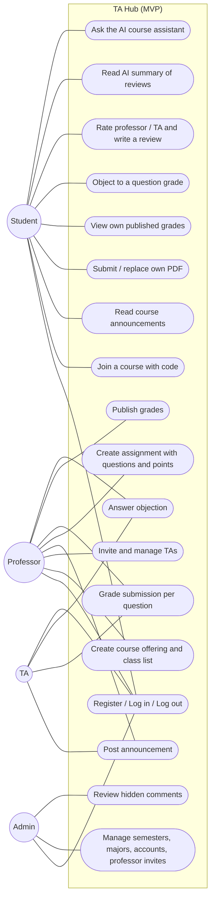
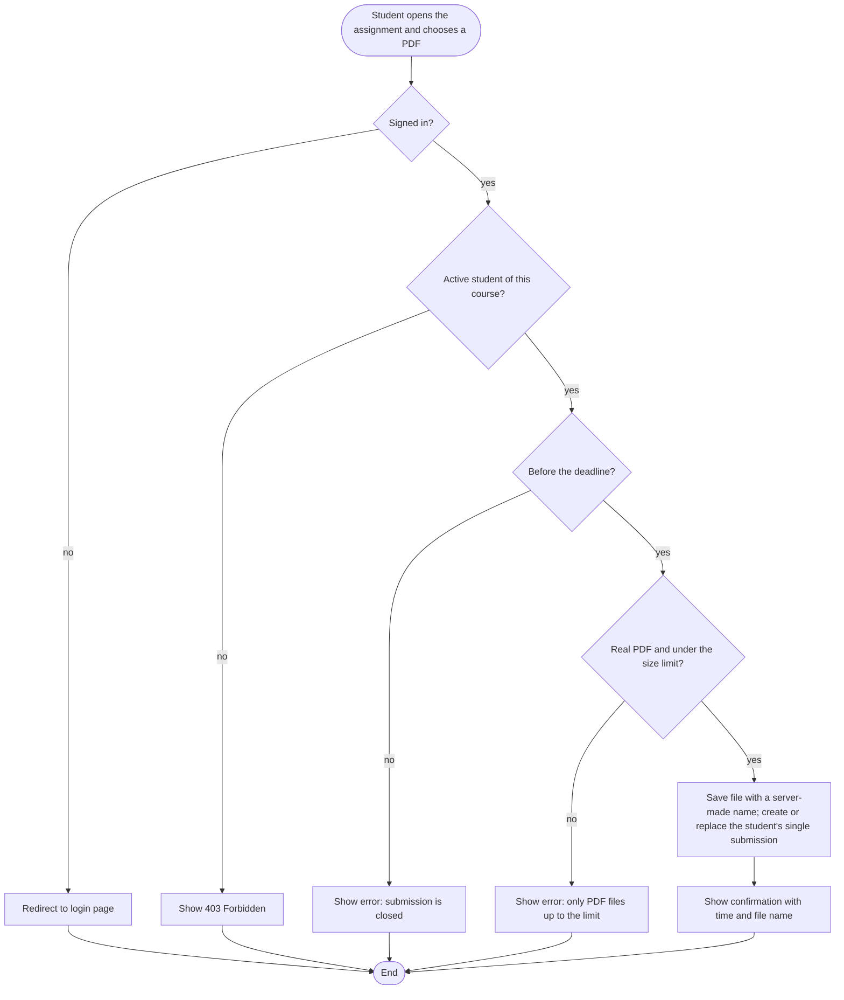
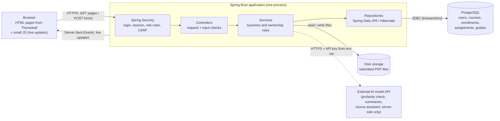
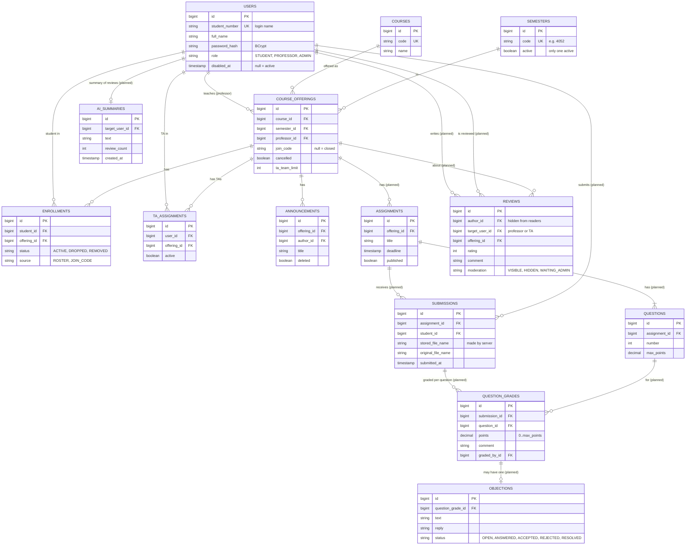

# TA Hub

یه سامانه‌ی تحت وب برای درس‌های دانشگاه. هر درس یه جای واحد داره برای ثبت‌نام، اطلاعیه، تیم TA، تمرین، تحویل PDF، نمره‌دهی سؤال‌به‌سؤال و اعتراض به نمره.

- درس: تحلیل و طراحی سیستم‌های نرم‌افزاری (SSAD)، پاییز ۱۴۰۵
- پروتوتایپ کلیک‌پذیر: https://sherviiinn.github.io/TAHub/prototype/ (فایلش: `docs/prototype/index.html`)
- نسخه‌ی آنلاین (HTTPS): در مرحله‌ی نهایی اضافه می‌شه
- نسخه‌ای که توی ارائه‌ی ۱ بررسی می‌شه: برچسب `presentation-1`

---

## ۱. مسئله و محدوده‌ی MVP

### مسئله
توی خیلی از درس‌ها کارهای درسی پخش‌وپلاست:
- تمرین‌ها توی گروه تلگرام یا ایمیل فرستاده می‌شن. استاد و TA باید ده‌ها فایل رو دستی جمع کنن، اسم‌گذاری کنن و بفهمن کی تحویل نداده.
- نمره‌ها توی فایل‌های اکسل جدا نگه داشته می‌شن. دانشجو معمولاً فقط نمره‌ی کل رو می‌بینه و نمی‌دونه هر سؤال چند گرفته.
- اعتراض به نمره با پیام شخصی انجام می‌شه و پیگیریش سخته.
- اطلاعیه‌ها، لیست TAها و لینک گروه‌ها جاهای مختلفن.

### کاربرها
| کاربر | کارش |
|---|---|
| دانشجو | ثبت‌نام توی درس، دیدن اطلاعیه، تحویل تمرین، دیدن نمره‌ی خودش، اعتراض |
| استاد | ساختن ارائه‌ی درس، لیست کلاس، تیم TA، تمرین، نمره‌دهی و انتشار نمره |
| TA (دستیار آموزشی) | یه دانشجو که توی یه درس دیگه نقش TA داره؛ نمره‌دهی و جواب اعتراض، با دسترسی‌هایی که استاد می‌ده |
| ادمین | ترم‌ها، رشته‌ها، حساب‌ها و کد دعوت استادها |

### MVP چی رو حل می‌کنه
**مسیر اصلی:** استاد برای درسش تمرین با سؤال و بارم می‌ذاره ← دانشجو قبل از مهلت فایل PDF جوابش رو تحویل می‌ده ← TA یا استاد برای هر سؤال نمره و توضیح می‌ذاره ← استاد نمره‌ها رو منتشر می‌کنه ← هر دانشجو فقط نمره‌ی خودش رو می‌بینه و اگه لازم بود به یه سؤال اعتراض می‌کنه.

برای اینکه این مسیر کار کنه، این‌ها هم لازمن: ثبت‌نام و ورود، ساختن درس و ارائه، ورود دانشجو به درس، و TA شدن یه دانشجو توی یه درس.

### اولویت‌بندی (MoSCoW)
| اولویت | قابلیت‌ها |
|---|---|
| **Must Have** | ثبت‌نام دانشجو، ورود و خروج، ورود استاد با کد دعوت، ساختن درس و ارائه، ورود دانشجو به درس با کد یا لیست کلاس، اضافه کردن TA، اطلاعیه‌ی درس، تمرین با سؤال و بارم، تحویل PDF، نمره‌دهی سؤال‌به‌سؤال، انتشار نمره، اعتراض به نمره، نظرسنجی استاد و TA، **بخش هوش مصنوعی** (فیلتر فحش توی نظرها، خلاصه‌ی نظرها، دستیار درسی) |
| **Should Have** | نوتیفیکیشن (زنده)، دسترسی‌های جدا برای هر TA و Head TA، جدول نمره (Grade Sheet) و خروجی CSV، دیدن PDF داخل سایت، پنل حساب‌ها برای ادمین (غیرفعال کردن حساب) |
| **Could Have** | منوی سلف، منابع آموزشی درس، اطلاعات دفتر استاد، بانک سؤال، برنامه‌ریز درسی، استخدام TA |
| **Won't Have (این ترم)** | اتصال به سامانه‌های خود دانشگاه (مثل گلستان)، اپ موبایل، پرداخت، چت زنده |

وضعیت فعلی: ثبت‌نام، ورود، درس‌ها، ثبت‌نام توی درس، تیم TA، اطلاعیه و نوتیفیکیشن ساخته و تست دستی شدن. تمرین، تحویل، نمره‌دهی، اعتراض، نظرسنجی و بخش هوش مصنوعی مرحله‌های بعدی‌ان (بخش ۹).

---

## ۲. User storyها و معیارهای پذیرش

### Must Have

**US-01: ثبت‌نام دانشجو**
به‌عنوان دانشجو، می‌خوام با شماره‌ی دانشجویی‌ام حساب بسازم، تا بتونم وارد درس‌هام بشم.
- شماره‌ی دانشجویی باید با فرمت دانشگاه بخونه (۱۱ رقم که سه رقم اولش سال ورودیه). شماره‌ی اشتباه با پیام واضح رد می‌شه.
- شماره‌ای که قبلاً ثبت شده دوباره قبول نمی‌شه.
- رمز با BCrypt ذخیره می‌شه، نه به‌صورت متن.
- اگه استادها قبلاً این شماره رو توی لیست کلاسشون گذاشته باشن، دانشجو بعد از ثبت‌نام خودکار وارد اون درس‌ها می‌شه.

**US-02: ورود و خروج**
به‌عنوان هر کاربر، می‌خوام وارد و خارج بشم، تا فقط خودم به اطلاعاتم دسترسی داشته باشم.
- با شماره‌ی دانشجویی (یا نام کاربری استاد) و رمز درست، کاربر وارد می‌شه و صفحه‌ها بر اساس نقشش نشون داده می‌شن.
- با رمز اشتباه وارد نمی‌شه و پیام خطا می‌بینه.
- کاربری که وارد نشده، با باز کردن هر صفحه‌ی داخلی به صفحه‌ی ورود فرستاده می‌شه.
- حسابی که ادمین غیرفعال کرده نمی‌تونه وارد بشه، و اگه الان وارد شده باشه با کلیک بعدی بیرون می‌ره.

**US-03: ثبت‌نام استاد با کد دعوت**
به‌عنوان استاد، می‌خوام با کدی که ادمین بهم داده حساب استادی بسازم، تا لازم نباشه ادمین برام حساب بسازه.
- کد ۱۰ حرفیه، فقط یه بار کار می‌کنه و ۱۴ روز اعتبار داره.
- کد اشتباه، استفاده‌شده، لغوشده یا منقضی رد می‌شه و هیچ حسابی ساخته نمی‌شه.
- دانشجو نمی‌تونه از راه ثبت‌نام معمولی نقش استاد بگیره.

**US-04: ساختن ارائه‌ی درس**
به‌عنوان استاد، می‌خوام برای درسم توی ترم فعال یه ارائه بسازم، تا دانشجوها و TAها بتونن واردش بشن.
- ارائه به یه درس دائمی، ترم فعال و استاد وصله. همون درس، همون ترم و همون استاد دو بار ساخته نمی‌شه.
- دانشجو نمی‌تونه ارائه بسازه (۴۰۳).
- ارائه‌ی ترم‌های قبل فقط دیدنیه و پاک نمی‌شه.

**US-05: ورود دانشجو به درس**
به‌عنوان دانشجو، می‌خوام با کد ورودی که استاد داده وارد درس بشم، تا اطلاعیه‌ها و تمرین‌های درس رو ببینم.
- با کد درست، دانشجو توی لیست درس ثبت می‌شه و بعد از رفرش هم هست.
- با کد اشتباه ثبت نمی‌شه و پیام خطا می‌بینه.
- دانشجویی که استاد حذفش کرده نمی‌تونه خودش برگرده (۴۰۳).
- TA همون درس نمی‌تونه دانشجوی همون درس هم باشه.
- استاد می‌تونه لیست شماره‌ها رو بچسبونه؛ کسایی که حساب دارن همون موقع وارد می‌شن و بقیه موقع ثبت‌نام.

**US-06: اضافه کردن TA**
به‌عنوان استاد، می‌خوام یه دانشجو رو به TA شدن توی درسم دعوت کنم، تا توی نمره‌دهی کمکم کنه.
- دعوت‌شده نوتیفیکیشن می‌گیره و می‌تونه قبول یا رد کنه؛ فقط بعد از قبول TA می‌شه.
- دانشجوی خود اون درس نمی‌تونه TAش بشه.
- وقتی تیم به سقفش رسیده، دعوت جدید ساخته نمی‌شه.
- فقط استاد (یا TAای که دسترسی مدیریت تیم داره) می‌تونه دعوت کنه.

**US-07: اطلاعیه‌ی درس**
به‌عنوان استاد یا TA، می‌خوام برای درس اطلاعیه بنویسم، تا همه‌ی دانشجوهای درس یه‌جا ببیننش.
- اطلاعیه رو فقط استاد، TAهای همون درس و دانشجوهای فعالش می‌بینن؛ بقیه ۴۰۳ می‌گیرن.
- دانشجوها نوتیفیکیشن می‌گیرن.
- TA فقط اطلاعیه‌ی خودش رو ویرایش یا پاک می‌کنه، مگه دسترسی مدیریت اطلاعیه‌ها رو داشته باشه.

**US-08: تمرین با سؤال و بارم**
به‌عنوان استاد، می‌خوام تمرین با مهلت، سؤال‌ها و بارم هر سؤال بسازم، تا بعداً بشه سؤال‌به‌سؤال نمره داد.
- تمرین عنوان، مهلت و حداقل یه سؤال با بارم مثبت داره؛ جمع بارم خودکار حساب می‌شه.
- تا منتشر نشده فقط استاد و TAها می‌بیننش؛ با انتشار، دانشجوهای فعال درس نوتیفیکیشن می‌گیرن.
- دانشجو نمی‌تونه تمرین بسازه یا عوض کنه (۴۰۳).

**US-09: تحویل PDF**
به‌عنوان دانشجو، می‌خوام قبل از مهلت فایل PDF جوابم رو آپلود کنم، تا لازم نباشه برای استاد یا TA بفرستمش.
- فقط دانشجوی فعال همون درس می‌تونه تحویل بده.
- فقط PDF واقعی (با چک محتوای فایل، نه فقط پسوند) و تا یه حجم مشخص قبول می‌شه؛ بقیه با پیام خطا رد می‌شن.
- برای هر تمرین فقط یه تحویل هست. تا قبل از مهلت می‌شه عوضش کرد یا پاکش کرد؛ بعد از مهلت قفل می‌شه.
- فایل با اسمی که سرور می‌سازه، بیرون از پوشه‌ی عمومی سایت ذخیره می‌شه.
- فایل هر دانشجو رو فقط خودش، استاد و TAهای درس می‌تونن دانلود کنن. یه دانشجو نمی‌تونه فایل دانشجوی دیگه رو ببینه یا عوض کنه (۴۰۳).

**US-10: نمره‌دهی سؤال‌به‌سؤال**
به‌عنوان TA، می‌خوام برای هر سؤال تحویل یه دانشجو نمره و توضیح بذارم، تا نمره‌ی کل خودکار حساب بشه.
- نمره‌ی هر سؤال بین صفر و بارم همون سؤاله؛ بیرون از این بازه رد می‌شه.
- نمره‌ی کل جمع نمره‌ی سؤال‌هاست.
- فقط استاد و TAهای همون درس نمره می‌دن. دانشجو و TAهای درس‌های دیگه ۴۰۳ می‌گیرن.

**US-11: انتشار و دیدن نمره**
به‌عنوان دانشجو، می‌خوام بعد از انتشار نمره‌ام رو برای هر سؤال ببینم، تا بدونم کجا نمره از دست دادم.
- تا استاد منتشر نکرده، دانشجو هیچ نمره‌ای نمی‌بینه.
- هر دانشجو فقط نمره‌ی خودش رو می‌بینه؛ درخواست برای نمره‌ی یکی دیگه رد می‌شه.

**US-12: اعتراض به نمره**
به‌عنوان دانشجو، می‌خوام به نمره‌ی یه سؤال اعتراض کنم، تا TA دوباره بررسیش کنه.
- برای هر سؤال حداکثر یه اعتراض ثبت می‌شه.
- TA جواب می‌ده و می‌تونه نمره رو عوض کنه؛ وضعیت اعتراض (باز، جواب‌داده‌شده، پذیرفته، رد، حل‌شده) برای دانشجو دیده می‌شه.
- دانشجو فقط به نمره‌ی خودش اعتراض می‌کنه.

**US-13: نظرسنجی استاد و TA**
به‌عنوان دانشجو، می‌خوام به استاد و TAهای درسم امتیاز بدم و نظر بنویسم، تا دانشجوهای بعدی بدونن با کی درس دارن.
- فقط دانشجوی فعال همون درس، و برای هر استاد یا TA توی هر ارائه فقط یه بار، می‌تونه نظر بده.
- نظرها بدون اسم نویسنده نشون داده می‌شن، ولی سرور می‌دونه نویسنده کیه (برای جلوگیری از سوءاستفاده).
- هر نظر قبل از نمایش از فیلتر فحش (US-14) رد می‌شه.

**US-14: فیلتر فحش با هوش مصنوعی**
به‌عنوان دانشجو، می‌خوام نظرهای توهین‌آمیز نشون داده نشن، تا بخش نظرها محترمانه بمونه.
- هر نظر اول با یه لیست کلمه (فارسی و انگلیسی) چک می‌شه؛ نظرهای مشکوک به مدل هوش مصنوعی فرستاده می‌شن.
- نظری که نشونه‌دار بشه پنهان می‌شه و برای بررسی به ادمین می‌ره؛ پاک نمی‌شه.
- ادمین می‌تونه نظر پنهان رو منتشر کنه یا پنهان نگه داره. هیچ کاربر دیگه‌ای نظرهای پنهان رو نمی‌بینه.
- اگه سرویس هوش مصنوعی در دسترس نباشه، نظر مشکوک منتشر نمی‌شه و منتظر بررسی ادمین می‌مونه.

**US-15: خلاصه‌ی نظرها با هوش مصنوعی**
به‌عنوان دانشجو، می‌خوام یه خلاصه‌ی کوتاه از نظرهای هر استاد یا TA ببینم، تا لازم نباشه همه‌ی نظرها رو بخونم.
- خلاصه فقط وقتی ساخته می‌شه که تعداد کافی نظر منتشرشده باشه.
- فقط متن نظرها، بدون اسم و شماره‌ی کسی، به مدل فرستاده می‌شه.
- کنار خلاصه برچسب «ساخته‌شده با هوش مصنوعی» و تاریخ ساختش هست.
- خلاصه ذخیره می‌شه و زمان‌بندی‌شده دوباره ساخته می‌شه، نه با هر بار باز شدن صفحه.

**US-16: دستیار درسی با هوش مصنوعی**
به‌عنوان دانشجو، می‌خوام سؤال درسی‌ام رو از یه دستیار بپرسم، تا وقتی TA در دسترس نیست هم کمک بگیرم.
- فقط کاربر واردشده می‌تونه بپرسه؛ هر کاربر توی روز تعداد محدودی سؤال داره و بعدش پیام «سقف امروز پر شده» می‌بینه.
- کنار هر جواب برچسب «ممکنه اشتباه باشه» هست.
- اطلاعات شخصی کاربر (اسم، شماره) به سرویس فرستاده نمی‌شه.
- اگه سرویس جواب نده، پیام خطای واضح نشون داده می‌شه.
- درخواست به مدل فقط از سمت سرور می‌ره و کلید API فقط توی متغیر محیطی سروره.

### Should Have
- **US-17: نوتیفیکیشن** – به‌عنوان کاربر، می‌خوام برای اطلاعیه، دعوت TA، تمرین جدید و نمره نوتیفیکیشن بگیرم، تا چیزی رو از دست ندم. (تعداد خونده‌نشده‌ها بدون رفرش عوض می‌شه.)
- **US-18: دسترسی‌های TA** – به‌عنوان استاد، می‌خوام برای هر TA مشخص کنم چه کارهایی بکنه، تا هر کسی فقط کار خودش رو بکنه. (Head TA می‌تونه تیم رو مدیریت کنه؛ کسی نمی‌تونه دسترسی‌ای بده که خودش نداره.)
- **US-19: جدول نمره و CSV** – به‌عنوان استاد، می‌خوام نمره‌ی همه‌ی دانشجوها رو توی یه جدول ببینم و خروجی CSV بگیرم.
- **US-20: پنل حساب‌ها** – به‌عنوان ادمین، می‌خوام حسابی که با شماره‌ی کس دیگه ساخته شده رو غیرفعال کنم و شماره رو آزاد کنم، بدون اینکه چیزی پاک بشه.

### Could Have
منوی سلف، منابع آموزشی، اطلاعات دفتر استاد، بانک سؤال، برنامه‌ریز درسی، استخدام TA. این‌ها فقط وقتی ساخته می‌شن که Must Haveها تموم شده باشن.

---

## ۳. معماری و دلیل انتخاب تکنولوژی‌ها

### معماری
یه برنامه‌ی **Monolith لایه‌لایه** که صفحه‌ها رو **سمت سرور** می‌سازه (Server-Side Rendering). مرورگر صفحه‌ی HTML آماده می‌گیره و فرم‌ها با درخواست‌های معمولی HTTP (GET و POST) به سرور می‌رن.

| لایه | کجای کد | کارش |
|---|---|---|
| صفحه‌ها (فرانت) | `src/main/resources/templates` (Thymeleaf)، `static/css`، `static/js` | نمایش صفحه و فرم‌ها. یه قالب مشترک (`fragments/layout.html`) منو و ظاهر رو برای همه‌ی صفحه‌ها یکی می‌کنه. همه‌ی متن‌ها توی `messages.properties`ـن. کمی جاوااسکریپت (`live.js`) برای آپدیت زنده. |
| Controllerها | `ir.TAHub.TAHub.*Controller` | گرفتن درخواست، چک ورودی‌ها (`findFirstError`)، صدا زدن سرویس و برگردوندن صفحه یا redirect |
| سرویس‌ها | `service` | قانون‌های کار، مثل اینکه کی می‌تونه چه کاری بکنه (`OfferingAccess`)، TA شدن (`TaService`)، فرمت شماره‌ی دانشجویی (`StudentNumberRules`) |
| دسترسی به داده | `repository` (Spring Data JPA) و `model` (Entityها) | خوندن و ذخیره‌ی داده توی PostgreSQL |
| امنیت | `config/SecurityConfig`، `security` | ورود، خروج، session، قانون آدرس‌ها بر اساس نقش، محافظت CSRF |
| تنظیمات | `application.properties` (روی سرور با متغیر محیطی عوض می‌شه) | آدرس و رمز دیتابیس، پوشه‌ی فایل‌ها و ... |

**هر چیزی کجاست:**
- **احراز هویت (کی وارد شده):** Spring Security با فرم ورود، رمزها با BCrypt، و session سمت سرور.
- **مجوز (کی چه کاری می‌تونه بکنه):** دو لایه. اول قانون آدرس‌ها بر اساس نقش توی `SecurityConfig` (مثلاً `/admin/**` فقط ادمین). بعد چک مالکیت توی کد، مثلاً «این کاربر استاد یا TA همین درسه؟» (`OfferingAccess`)، چون قانون آدرس نمی‌دونه هر رکورد مال کیه. مخفی کردن دکمه هیچ‌وقت تنها محافظت نیست.
- **چک ورودی‌ها:** توی Controllerها، قبل از ذخیره. اولین خطا با پیام واضح به کاربر نشون داده می‌شه.
- **ذخیره‌ی داده:** PostgreSQL. فایل‌های PDF روی دیسک سرور، و فقط مسیرشون توی دیتابیس.

### چرا این انتخاب‌ها
- **Java 21 و Spring Boot:** امنیت (ورود، session، CSRF، BCrypt) آماده و جاافتاده‌ست و لازم نیست از صفر ساخته بشه. تیم با جاوا آشناتره.
- **ساخت صفحه سمت سرور (Thymeleaf) به‌جای React و یه API جدا:** یه برنامه، یه بار اجرا و یه جا برای آنلاین کردن. نیازی به مدیریت توکن توی مرورگر نیست. برای تیم سه‌نفره توی یه ترم سریع‌تره.
  - **ضعفش:** صفحه‌ها کمتر تعاملی‌ان (برای جاهای لازم کمی جاوااسکریپت داریم)، و API عمومی JSON برای اپ موبایل نداریم. اگه بعداً لازم شد، می‌شه کنار همین سرویس‌ها اضافه‌اش کرد.
- **PostgreSQL (دیتابیس رابطه‌ای):** داده‌ها به هم وصلن (کاربر، درس، ثبت‌نام، تمرین، نمره). قید یکتا (مثلاً یه ثبت‌نام برای هر دانشجو و درس، یه تحویل برای هر تمرین) و تراکنش لازمه.
- **Docker برای دیتابیس:** همه‌ی اعضای تیم با یه دستور همون دیتابیس رو بالا میارن.
- **هوش مصنوعی:** از API یه مدل آماده استفاده می‌کنیم، نه ساختن مدل از صفر. همه‌ی درخواست‌ها فقط از سمت سرور می‌رن و کلید API فقط توی متغیر محیطیه. یه رابط ساده (`AiClient`) بین برنامه و سرویس هست تا بشه سرویس رو عوض کرد و توی تست‌ها یه نسخه‌ی تقلبی جاش گذاشت.

### مسیر کامل یه کار از صفحه تا دیتابیس (ورود دانشجو به درس با کد)
1. **صفحه:** دانشجو توی صفحه‌ی درس کد ورود رو می‌نویسه و «Join» رو می‌زنه. مرورگر `POST /courses/{id}/enroll` رو با `code` (و توکن CSRF) می‌فرسته.
2. **امنیت:** Spring Security از روی session می‌فهمه کاربر کیه. اگه وارد نشده باشه، به `/login` فرستاده می‌شه.
3. **Controller و قانون‌ها:** `EnrollmentController.enroll` چک می‌کنه کاربر دانشجوئه، ترم فعاله، ارائه لغو نشده، TA همین درس نیست و قبلاً توسط استاد حذف نشده؛ در غیر این صورت ۴۰۳. بعد کد رو چک می‌کنه.
4. **دیتابیس:** یه ردیف توی `enrollments` با وضعیت `ACTIVE` و منبع `JOIN_CODE` یا `ROSTER` ذخیره می‌شه (برای هر دانشجو و ارائه فقط یه ردیف).
5. **جواب:** سرور به صفحه‌ی درس redirect می‌کنه و دانشجو حالا اطلاعیه‌ها و بقیه‌ی درس رو می‌بینه. اگه کد اشتباه بود، همون صفحه با پیام خطا (`?joinError`) باز می‌شه.

---

## ۴. نمودارها

### ۱) Use Case

TA خودش یه دانشجوئه که توی یه درس نقش TA داره؛ کارهایی که می‌کنه به دسترسی‌هایی بستگی داره که استاد بهش داده.

### ۲) Activity: تحویل تمرین توسط دانشجو (با مسیرهای خطا)


### ۳) معماری سیستم


### ۴) ERD (جدول‌های اصلی MVP)
جدول‌هایی که با «planned» مشخص شدن مال مرحله‌های بعدی‌ان (تمرین، تحویل، نمره، اعتراض، نظرسنجی و هوش مصنوعی). بقیه الان توی دیتابیس هستن.

**قیدهای مهم:**
- `ENROLLMENTS`: یکتا روی (student_id، offering_id). یه دانشجو توی یه ارائه فقط یه ردیف داره؛ حذف یعنی عوض شدن وضعیت، نه پاک شدن.
- `TA_ASSIGNMENTS`: یکتا روی (user_id، offering_id). دانشجوی یه درس نمی‌تونه TA همون درس باشه (توی کد چک می‌شه).
- `COURSE_OFFERINGS`: یکتا روی (course_id، semester_id، professor_id).
- `SUBMISSIONS`: یکتا روی (assignment_id، student_id). هر دانشجو برای هر تمرین فقط یه تحویل داره.
- `QUESTION_GRADES`: یکتا روی (submission_id، question_id). `OBJECTIONS`: یکتا روی question_grade_id (حداکثر یه اعتراض برای هر سؤال).
- `REVIEWS`: یکتا روی (author_id، target_user_id، offering_id). هر دانشجو برای هر استاد یا TA توی هر ارائه یه نظر.
- هیچ سابقه‌ای واقعاً پاک نمی‌شه؛ رکوردها وضعیت یا پرچم پنهان دارن.

جدول‌های دیگه‌ای هم هستن که بیرون از مسیر اصلی‌ان (نوتیفیکیشن، دعوت و درخواست TA، منابع، سلف و ...). فهرست کاملشون توی `project-contex.md` (بخش ۵) هست.

---

## ۵. لیست API (آدرس‌های HTTP)

برنامه صفحه‌ها رو سمت سرور می‌سازه، پس «API» ما همین آدرس‌های GET و POST ـه: GET یه صفحه‌ی HTML برمی‌گردونه و POST یه فرم رو انجام می‌ده و به یه صفحه redirect می‌کنه. همه‌ی POSTها توکن CSRF لازم دارن.
خطاهای مشترک: کاربر واردنشده ← redirect به `/login`؛ کاربر بدون اجازه ← `403 Forbidden`؛ رکورد ناموجود ← `404`؛ ورودی اشتباه ← همون صفحه با پیام خطا.

| متد و آدرس | ورودی | جواب موفق | خطاهای ممکن | وضعیت |
|---|---|---|---|---|
| `POST /register` | `fullName`، `studentNumber`، `majorId`، `password`، `confirmPassword` | redirect به `/login?registered` | شماره‌ی اشتباه یا تکراری، رمز کوتاه یا ناهمخوان (پیام روی صفحه) | ساخته شده |
| `POST /register/professor` | `code`، `fullName`، `username`، `password`، `confirmPassword` | redirect به `/login?registered` | کد نامعتبر یا استفاده‌شده، نام کاربری تکراری | ساخته شده |
| `POST /login` | `username`، `password` | redirect به `/` | `/login?error` (اشتباه)، `/login?disabled` (حساب غیرفعال) | ساخته شده |
| `POST /logout` | – | redirect به `/login?logout` | – | ساخته شده |
| `GET /courses` | – | لیست ارائه‌های ترم فعال | واردنشده | ساخته شده |
| `POST /courses` | `code`، `name`، `professorId` (فقط ادمین) | redirect به صفحه‌ی ارائه | ۴۰۳ برای دانشجو؛ تکراری بودن | ساخته شده |
| `GET /courses/{id}` | – | صفحه‌ی ارائه (چیزهایی که هر نقش اجازه داره ببینه) | ۴۰۴ | ساخته شده |
| `POST /courses/{id}/enroll` | `code` | redirect به صفحه‌ی ارائه | `?joinError` (کد اشتباه)؛ ۴۰۳ (حذف‌شده، TA، ترم بسته) | ساخته شده |
| `POST /courses/{id}/roster` | لیست شماره‌ها (متن) | خلاصه‌ی نتیجه روی صفحه | ۴۰۳ برای غیر استاد | ساخته شده |
| `POST /courses/{id}/tas` | شماره‌ی دانشجویی | دعوت TA ساخته می‌شه | ۴۰۳؛ دانشجوی همین درس؛ تیم پر | ساخته شده |
| `POST /ta-invitations/{id}/accept` | – | کاربر TA می‌شه | ۴۰۳ اگه دعوت مال کس دیگه‌ست | ساخته شده |
| `GET /courses/{id}/announcements` | – | اطلاعیه‌های درس | ۴۰۳ برای کسی که توی درس نیست | ساخته شده |
| `POST /courses/{id}/announcements` | `title`، `body` | redirect به اطلاعیه‌ها | ۴۰۳ بدون دسترسی؛ خالی یا بلند بودن | ساخته شده |
| `POST /courses/{id}/assignments` | `title`، `description`، `deadline`، سؤال‌ها و بارم‌ها | redirect به صفحه‌ی تمرین | ۴۰۳ برای دانشجو؛ مهلت یا بارم نامعتبر | برنامه‌ریزی‌شده |
| `GET /assignments/{id}` | – | صفحه‌ی تمرین (برای دانشجو: وضعیت تحویل خودش) | ۴۰۳ برای کسی که توی درس نیست | برنامه‌ریزی‌شده |
| `POST /assignments/{id}/submission` | فایل `file` (multipart) | redirect با پیام «تحویل شد» | ۴۰۳؛ مهلت گذشته؛ فایل غیر PDF یا بزرگ | برنامه‌ریزی‌شده |
| `POST /assignments/{id}/submission/delete` | – | تحویل پاک می‌شه | ۴۰۳؛ مهلت گذشته | برنامه‌ریزی‌شده |
| `GET /submissions/{id}/file` | – | فایل PDF | ۴۰۳ برای هر کسی غیر از صاحبش، استاد و TAهای درس | برنامه‌ریزی‌شده |
| `GET /assignments/{id}/submissions` | – | لیست تحویل‌ها (تحویل داده / نداده) | ۴۰۳ برای دانشجو | برنامه‌ریزی‌شده |
| `POST /submissions/{id}/grades` | نمره و توضیح هر سؤال | redirect با پیام «ذخیره شد» | ۴۰۳؛ نمره بیرون از بازه | برنامه‌ریزی‌شده |
| `POST /assignments/{id}/publish-grades` | – | دانشجوها نمره‌ی خودشون رو می‌بینن | ۴۰۳ برای غیر استاد | برنامه‌ریزی‌شده |
| `GET /assignments/{id}/my-grade` | – | نمره‌ی سؤال‌به‌سؤال خود دانشجو | منتشر نشده؛ ۴۰۳ | برنامه‌ریزی‌شده |
| `POST /question-grades/{id}/objection` | `text` | اعتراض ثبت می‌شه | ۴۰۳ (نمره‌ی کس دیگه)؛ اعتراض تکراری | برنامه‌ریزی‌شده |
| `POST /objections/{id}/reply` | `reply`، نمره‌ی جدید (اختیاری) | وضعیت اعتراض عوض می‌شه | ۴۰۳ برای غیر TA یا استاد درس | برنامه‌ریزی‌شده |
| `POST /users/{targetId}/reviews` | `offeringId`، `rating`، `comment` | نظر ثبت می‌شه (اگه مشکوک باشه پنهان و منتظر ادمین) | ۴۰۳ (دانشجوی اون درس نیست)؛ نظر تکراری؛ امتیاز نامعتبر | برنامه‌ریزی‌شده |
| `GET /professors/{id}` | – | صفحه‌ی استاد با نظرهای منتشرشده و خلاصه‌ی هوش مصنوعی | ۴۰۴ | ساخته شده (بدون نظرها) |
| `POST /assistant/ask` | `question` | جواب دستیار با برچسب «ممکنه اشتباه باشه» | واردنشده؛ سقف روزانه پر شده؛ سرویس در دسترس نیست | برنامه‌ریزی‌شده |
| `GET /admin/reviews/hidden` | – | لیست نظرهای پنهان‌شده | ۴۰۳ برای غیر ادمین | برنامه‌ریزی‌شده |
| `POST /admin/reviews/{id}/publish` و `/keep-hidden` | – | وضعیت نظر عوض می‌شه | ۴۰۳ برای غیر ادمین | برنامه‌ریزی‌شده |

---

## ۶. برنامه‌ی آنلاین کردن (میزبانی)

برنامه یه فایل JAR جاواست که کنار یه دیتابیس PostgreSQL و یه دیسک برای فایل‌های PDF اجرا می‌شه.

| گزینه | چی می‌گیریم | هزینه‌ی ماهانه | محدودیت‌ها |
|---|---|---|---|
| **لیارا** (پیشنهاد اول، سرویس ایرانی) | اجرای برنامه با Docker، PostgreSQL مدیریت‌شده، دیسک برای فایل‌ها، HTTPS و ساب‌دامنه‌ی رایگان | `[از liara.ir/pricing پر بشه]` | برنامه‌ی جاوا حداقل حدود ۱ گیگ رم می‌خواد؛ هزینه بر اساس منابع |
| سرور مجازی ایرانی (VPS) | یه سرور لینوکس که همه‌چیز (برنامه، دیتابیس، Nginx و گواهی Let's Encrypt) رو خودمون روش نصب می‌کنیم | `[قیمت پر بشه]` | نگهداری، بکاپ و امنیت با خودمونه |
| سرویس‌های خارجی (مثل Render) | پلن رایگان | صفر | پرداخت از ایران سخته؛ پلن رایگان بعد از مدتی بی‌کاری می‌خوابه؛ ممکنه از داخل ایران کند باشه |

**تصمیم فعلی:** لیارا، چون HTTPS و دیتابیس آماده داره، از داخل ایران در دسترسه و نگهداری کمی لازم داره.
**نکته‌های امنیتی قبل از آنلاین کردن:** رمز دیتابیس و رمز ادمین فقط توی متغیر محیطی، `tahub.demo-data` خاموش، و دیسک فایل‌ها بیرون از پوشه‌ی عمومی.

---

## ۷. اجرای برنامه روی کامپیوتر خودتون

### پیش‌نیازها
- JDK 21
- Docker Desktop
- Git
- (اختیاری) IntelliJ IDEA

### مراحل
```bash
git clone <آدرس این ریپو>
cd TAHub
docker compose up -d          # PostgreSQL 16 on port 5433
./mvnw spring-boot:run        # on Windows: mvnw.cmd spring-boot:run
```
بعد آدرس `http://localhost:8080` رو باز کنید.

- ادمین پیش‌فرض: نام کاربری `admin`، رمز `admin123` (فقط برای اجرای لوکال).
- با `tahub.demo-data=true` توی `application.properties`، دیتابیس خالی با داده‌ی نمونه پر می‌شه: دو استاد (`karimi` و `hosseini`) و شش دانشجو (مثل `40312100001`)، همه با رمز `demo12345`.
- برای شروع از اول: `docker compose down -v` و بعد `docker compose up -d`.

### تست
```bash
./mvnw test
```
تست‌های خودکار ورود، دسترسی‌ها و مسیر اصلی در مرحله‌ی بعد (تا ارائه‌ی ۲) اضافه می‌شن.

---

## ۸. اعضای تیم و سهم هر نفر

| نام | نقش | کارهای انجام‌شده تا الان |
|---|---|---|
| شروین | بک‌اند و دیتابیس | طراحی دیتابیس، ورود و دسترسی‌ها، درس‌ها و ثبت‌نام، تیم TA، اطلاعیه و نوتیفیکیشن، پنل حساب‌ها |
| مهرسا | فرانت‌اند | قالب مشترک صفحه‌ها، منو، CSS و فونت، طراحی صفحه‌ها |
| ماهان | هوش مصنوعی | طراحی بخش هوش مصنوعی (فیلتر فحش، خلاصه‌ی نظرها، دستیار درسی) و انتخاب سرویس مدل؛ پیاده‌سازی از مرحله‌ی بعد |

همه‌ی اعضا توی تعریف نیازها، user storyها و نمودارها شریکن.

**کارهای تموم‌نشده:** تمرین و تحویل PDF، نمره‌دهی و انتشار نمره، اعتراض، نظرسنجی، بخش هوش مصنوعی، تست‌های خودکار، و آنلاین کردن روی HTTPS.

---

## ۹. برنامه‌ی کار

| زمان (۱۴۰۵) | کار |
|---|---|
| تا ۲۴ آبان | ارائه‌ی ۱: طراحی، user storyها، نمودارها، پروتوتایپ، لیست API |
| ۲۷ آبان تا ۲۲ آذر | تست خودکار ورود و دسترسی‌ها؛ تمرین و تحویل PDF؛ هم‌زمان: رابط `AiClient` و دستیار درسی (ماهان)؛ ارائه‌ی ۲ |
| ۲۵ آذر تا ۱۷ دی | نمره‌دهی، انتشار نمره، اعتراض، نظرسنجی، فیلتر فحش و خلاصه‌ی نظرها (تموم شدن Must Haveها) |
| ۱۸ تا ۳۰ دی | آنلاین کردن، رفع باگ، مستندات؛ بسته شدن کد تا ۳۰ دی |
| تا ۳ بهمن | تحویل نهایی؛ ارائه‌ی ۳ در ۵ و ۶ بهمن |
