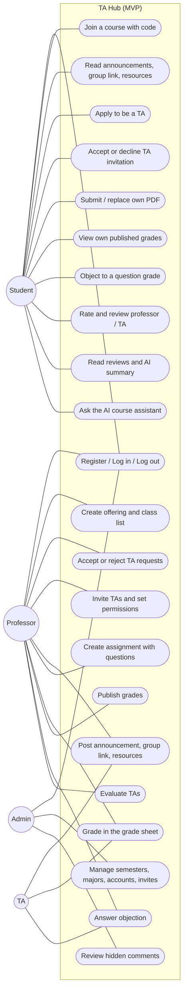
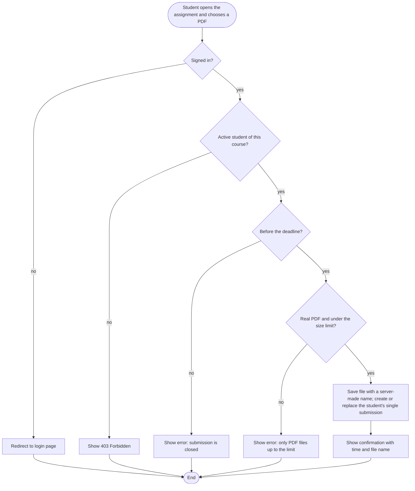
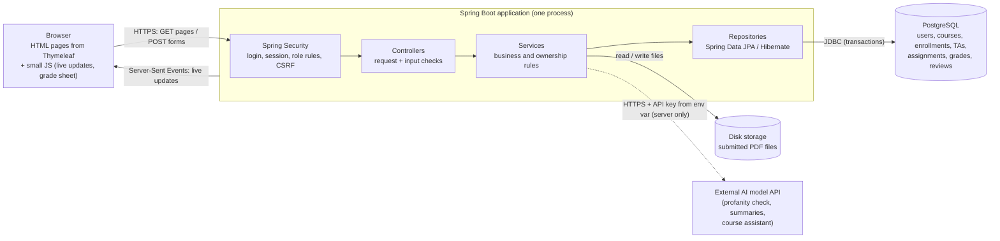
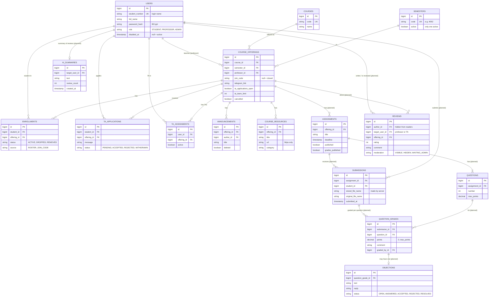

# فاز ۲: نمودارهای طراحی

**زمان در برنامه‌ی ترم:** ۱۶ تا ۲۰ آبان ۱۴۰۵
**خروجی این فاز:** نمودار مورد کاربرد (Use Case)، نمودار فعالیت (Activity)، نمودار معماری سیستم و نمودار داده‌ها (ERD). نمودارها با Mermaid نوشته شدن و GitHub خودش نشونشون می‌ده؛ نسخه‌ی عکس هر کدوم هم کنارش توی همین پوشه هست.

[بازگشت به فهرست مستندات](../README.md)

---

## نمودارها

نمودار مورد کاربرد فقط قابلیت‌های باید و بهتره‌ی MVP رو نشون می‌ده.

### Use Case

Image version: [use-case.png](use-case.png)

TA هم یه دانشجوئه، پس همه‌ی کارهای دانشجو رو هم می‌تونه بکنه. کارهای TA به دسترسی‌هایی بستگی داره که استاد بهش داده.

### Activity: submitting a PDF (with error paths)

Image version: [activity-submit-pdf.png](activity-submit-pdf.png)

### System architecture

Image version: [architecture.png](architecture.png)

### ERD (main MVP tables)

Image version: [erd.png](erd.png)

جدول‌هایی که کنارشون «planned» نوشته شده مال مرحله‌های بعدی‌ان. بقیه الان توی دیتابیس هستن.

**قیدهای مهم:**
- **ثبت‌نام‌ها:** برای هر دانشجو و ارائه فقط یه ردیف. حذف یعنی عوض شدن وضعیت، نه پاک شدن.
- **درخواست‌های TA:** برای هر دانشجو و ارائه فقط یه درخواست.
- **TAها:** برای هر کاربر و ارائه یه ردیف. دانشجوی یه درس نمی‌تونه TA همون درس باشه (توی کد چک می‌شه).
- **ارائه‌ها:** یکتا روی درس، ترم و استاد.
- **تحویل‌ها:** هر دانشجو برای هر تمرین فقط یه تحویل.
- **نمره‌ها:** برای هر تحویل و سؤال یه نمره. هر نمره حداکثر یه اعتراض داره.
- **نظرها:** هر دانشجو برای هر استاد یا TA توی هر ارائه یه نظر.
- هیچ سابقه‌ای واقعاً پاک نمی‌شه؛ رکوردها وضعیت یا پرچم پنهان دارن.

جدول‌های دیگه‌ای هم هستن که بیرون از مسیرهای اصلی‌ان (نوتیفیکیشن، دعوت TA، سلف و ...). فهرست کاملشون توی `project-contex.md` (بخش ۵) هست.

